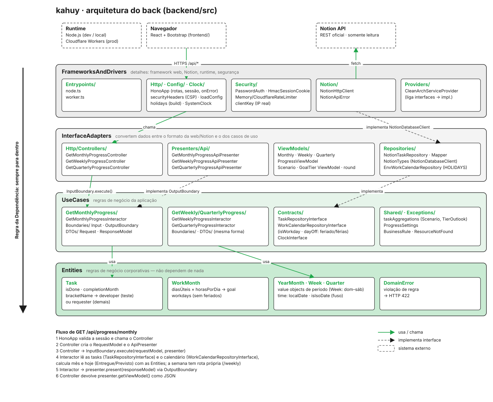

# kahuy · backend

The kahuy API. It reads your Notion database and returns progress already computed (ViewModels), so the
front only displays it. Built with Hono, strict TypeScript, and Vitest. The same app runs on Node (local)
and on Cloudflare Workers; only the entrypoint changes (`Entrypoints/node.ts` · `worker.ts`).

<p align="center"></p>

## Commands

```bash
npm run dev                # Node + tsx watch on 127.0.0.1:8787
npm start                  # same, without watch
npm test                   # Vitest, no network
npm run typecheck
npm run holidays -- 2028   # adds that year's national holidays (BrasilAPI) to holidays.json
npm run cf:secrets         # sends .env + holidays.local.json as Worker secrets
npm run deploy             # deploys the kahuy-api Worker
```

## API

| Method | Route | Session | Response |
|---|---|---|---|
| GET | `/api/health` | no | `{ "ok": true }` |
| POST | `/api/login` | no | `{ "password" }` → 204 + `kahuy_session` cookie |
| POST | `/api/logout` | yes | 204 |
| GET | `/api/progress/monthly?month=YYYY-MM` | yes | `MonthlyProgressViewModel` (default: current month) |
| GET | `/api/progress/weekly?week=YYYY-MM-DD` | yes | `WeeklyProgressViewModel` for the Sun–Sat week containing that date (default: current week) |
| GET | `/api/progress/quarterly?quarter=YYYY-Qn` | yes | `QuarterlyProgressViewModel` (default: current quarter) |

Errors: 401 (no session or wrong password), 422 (invalid parameter), 429 (login rate limit, with
`Retry-After`), 502 (a mapped field doesn't exist, or Notion failed). A task with invalid data, such as
negative hours, is not an error: it's left out of the totals and listed in `invalidTasks`.

Response types live in `src/InterfaceAdapters/ViewModels/`; the front imports them directly.

## Where things live

Only **two files are yours**, and both are git-ignored. Everything else is the same for every install
and is versioned.

| File | In git? | Sensitive? | Contents | Create / update | On Cloudflare |
|---|---|---|---|---|---|
| `backend/.env` | **no** | **yes** | Notion token, database ID, password, your preferences | `cp .env.example .env` | Worker secrets (`./deploy.sh secrets`) |
| `backend/holidays.local.json` | **no** | **yes** (personal) | your vacation and days off | copy `holidays.local.example.json` | `HOLIDAYS` secret (same command) |
| `backend/.env.example` | yes | no | `.env` template with fake values | — | — |
| `backend/holidays.local.example.json` | yes | no | `holidays.local.json` template | — | — |
| `backend/holidays.json` | yes | no | national holidays (public) | `npm run holidays -- YYYY` | bundled into the API |
| `backend/wrangler.toml` · `frontend/wrangler.toml` | yes | no | Worker/Pages names, rate limit, binding | — | read on deploy |

- Never put a secret in a versioned file or in the front. The front has no `.env` and never sees the token.
- `cf:secrets` writes a temporary `.wrangler-secrets.json` (also git-ignored) and deletes it right after.
- Changing `KAHUY_PASSWORD` logs out every open session, because the cookie is signed with it.

## Variables

Local: `backend/.env` (copy `.env.example`). Cloudflare: `npm run cf:secrets`. An invalid configuration
stops the API from starting, with a message saying what to fix.

| Variable | Default | Meaning |
|---|---|---|
| `NOTION_TOKEN` | required | integration token (read-only) |
| `NOTION_DATABASE_ID` | required | tasks database ID |
| `KAHUY_PASSWORD` | required | dashboard password, ≥ 16 chars; quote it if it has `#` or spaces |
| `NOTION_FIELD_TITLE` · `_HOURS` · `_STATUS` · `_DATE` · `_TYPE` | `Task` · `Horas` · `Status` · `Data` · `Tipo` | database columns |
| `DONE_STATUSES` | `Concluido` | statuses that count as done, comma-separated |
| `TEST_TYPES` | `TESTE` | test task types (the `[Name]` in the title is the developer) |
| `HOURS_PER_DAY` | `8` | hours per workday |
| `GOAL_TIERS` | `100,125` | goal tiers, in % |
| `HOLIDAYS` | | your days off (see [Holidays](#holidays)) |
| `WORKING_DAYS` | | forces a month's workday count, e.g. `{"2026-11":19}` |
| `TIMEZONE` | `America/Sao_Paulo` | time zone for Notion dates |
| `PORT` | `8787` | local port (always on `127.0.0.1`) |
| `TRUST_PROXY` | `false` | Node behind your own reverse proxy: rate-limit login by `X-Forwarded-For` |
| `ALLOWED_ORIGIN` | | CORS, only if the front is on another subdomain (the cookie is `SameSite=Strict`) |

## Holidays

A workday is Mon–Fri outside holidays. Holiday files map a date to a name: `{ "2026-11-02": "Finados" }`.

- **National:** `holidays.json`, versioned and bundled into the API. For a new year, run
  `npm run holidays -- YYYY` and redeploy. A year with no holidays shows its goal as *estimated*.
  Carnival and Corpus Christi are added as optional days off; delete them if you work on those days.
- **Personal** (vacation, days off): `holidays.local.json` (git-ignored; template in
  `holidays.local.example.json`) or the `HOLIDAYS` variable, which wins if both exist. On Cloudflare, edit
  `HOLIDAYS` in the Worker dashboard. If a date is in both lists, the personal one wins: the calendar
  shows it as vacation.
